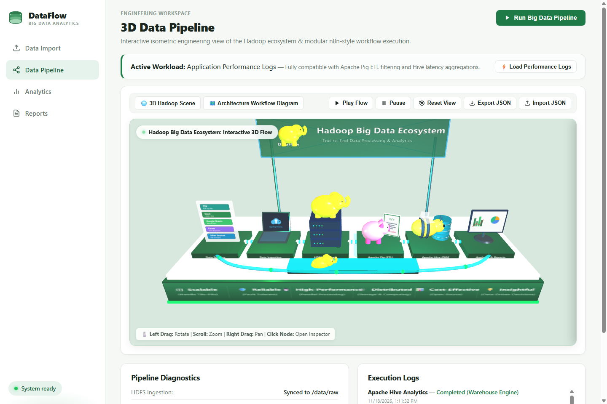
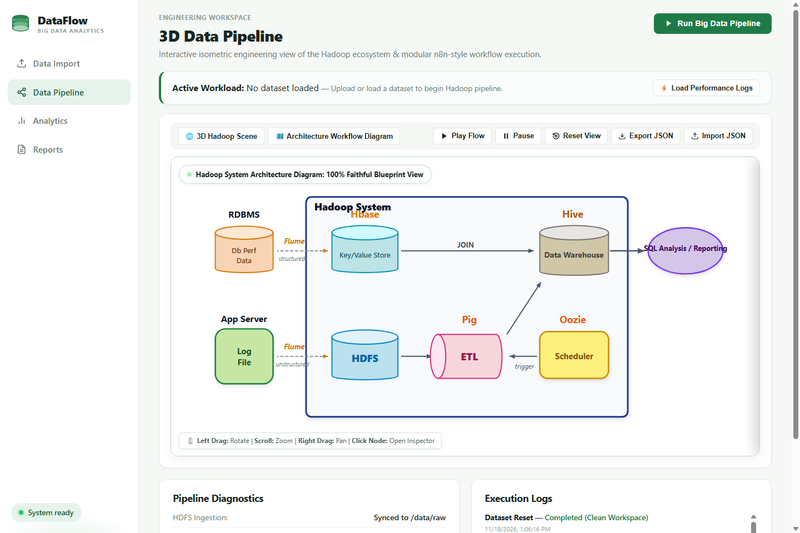
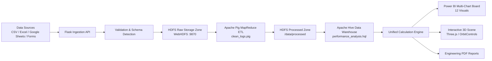
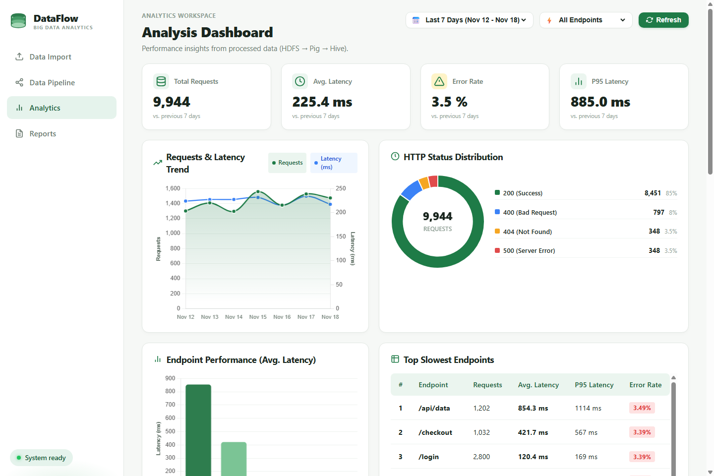
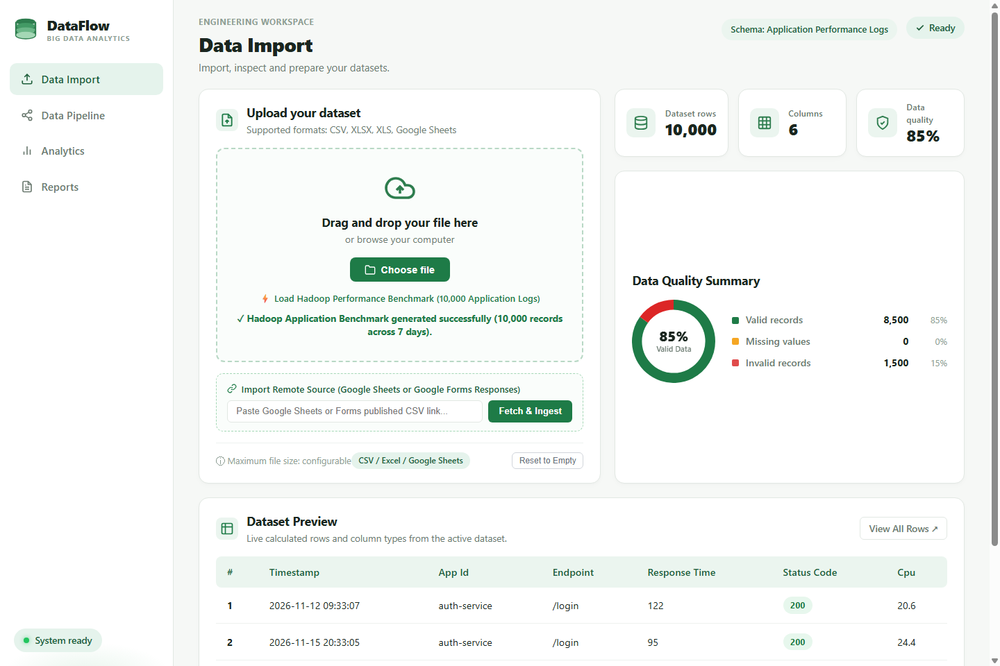
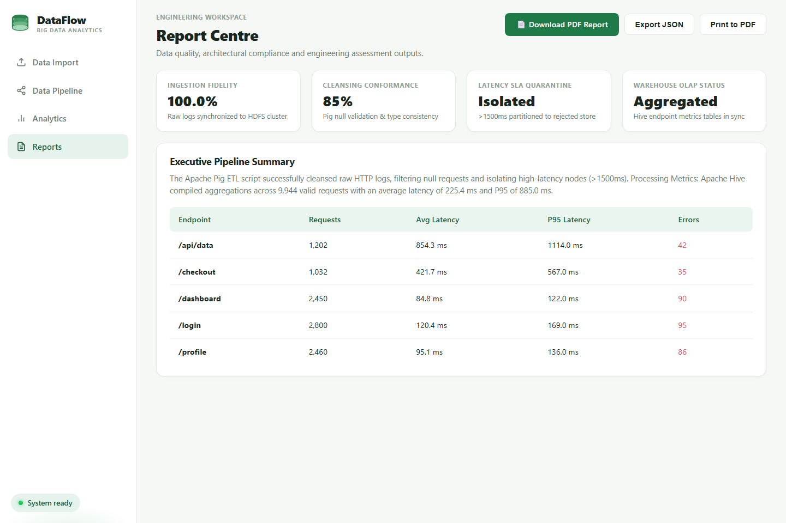

# DataFlow — Full-Stack Big Data Analytics Platform

<p align="center">
  
</p>

<p align="center">
  <strong>Import · Store · Transform · Analyze · Visualize</strong><br/>
  An enterprise-grade Big Data Engineering & Application Performance Analytics platform featuring interactive 3D architecture, multi-chart Power BI analytics, and Apache Hadoop ecosystem workflows.
</p>

<p align="center">
  
  
  
  
  
  
  
  
  <a href="https://dataflow-expert-engine-frontend.vercel.app/" target="_blank">
    
  </a>
</p>

<p align="center">
  🔗 <strong>Live Deployment:</strong> <a href="https://dataflow-expert-engine-frontend.vercel.app/" target="_blank">https://dataflow-expert-engine-frontend.vercel.app/</a>
</p>

---

## 1. Project Overview

**DataFlow** is a modern Big Data Engineering and Application Performance Analytics system. It bridges distributed big data storage and processing (Hadoop HDFS, Apache Pig, Apache Hive) with an intuitive, interactive SaaS workspace featuring:

- **Interactive 3D Hadoop Ecosystem**: Built in Three.js with modular station stages, animated CatmullRom spline energy flows, mascots, and clickable node inspection.
- **100% Faithful 2D Architecture Blueprint**: SVG diagram matching industrial Big Data system specifications.
- **Power BI-Style Analytics Board**: 12 responsive analytical visualizations driven by a single unified calculation engine.
- **Intelligent Schema Detection**: Automatically identifies Application Logs, Taxi-Zone datasets, Commercial Sales, and generic CSVs.
- **Pristine Empty State Guarantee**: Displays clear indicators (`—` and *Not Available*) when no dataset is loaded, avoiding fabricated measurements.
- **Audit & Engineering Reports**: Automated executive summaries and exportable compliance reports (PDF, JSON, Print).

---

## 2. End-to-End Architecture

<p align="center">
  
</p>



### Processing Stages

| Stage | Component | Technology | Responsibility |
|---|---|---|---|
| **1. Ingestion** | Data Sources & Upload | Flask REST API + UI | Accepts drag-and-drop CSV/Excel, Google Sheets/Forms URLs, or synthetic benchmark generator. |
| **2. Validation** | Schema Detection Engine | Python & pandas | Detects schema profile, parses timestamps, enforces SLA limits, validates HTTP status codes. |
| **3. Distributed Storage** | HDFS Cluster | Hadoop 3.2.1 | Raw and cleansed data stored in distributed blocks with 3x replication factor. |
| **4. Distributed ETL** | Apache Pig | MapReduce / Pig Latin | Null handling, data type consistency, and quarantine of latency spikes (>1500ms). |
| **5. Data Warehouse** | Apache Hive | HiveQL (HQL) / ORC | External table schemas, partition management, and analytical aggregations. |
| **6. Visualization** | Analytics Workspace | Chart.js + Three.js | 12 deep-dive visuals, dual-axis trend analysis, and animated 3D ecosystem flow. |
| **7. Reporting** | Audit Centre | Matplotlib / ReportLab | Ingestion fidelity, cleansing conformance scorecards, and downloadable PDF reports. |

---

## 3. Application Workspaces

### 🌐 3D Hadoop Ecosystem & Architecture Pipeline
Switch dynamically between a futuristic 3D showroom stage and a 2D engineering blueprint diagram.
<p align="center">
  
</p>

- **Top Floating Glass Canopy**: DataFlow branding & Hadoop ecosystem header.
- **6 Modular Stations**:
  1. *Data Sources*: Glass vertical tablet with CSV, Excel, Google Sheets, Forms, and Streams.
  2. *Data Ingestion*: 3D laptop with glowing cloud upload screen.
  3. *HDFS Storage*: Blue 3-tier server rack with cyan/green LEDs & 3D Yellow Elephant mascot.
  4. *Apache Pig (ETL)*: 3D Pink Pig mascot + ETL code document card (`</>`).
  5. *Apache Hive (DW)*: 3D Striped Bee mascot + cyan tiered storage drums.
  6. *Analytics & Reports*: 3D Desktop monitor with real-time charts.
- **Neon Track & Pedestal**: Glowing cyan track loop with yellow elephant and illuminated `hadoop` lettering; emerald green beveled stage with 6 capability badges (*Scalable*, *Reliable*, *High-Performance*, *Distributed*, *Cost-Effective*, *Insightful*).
- **Interactive Inspection**: Left-drag to rotate, scroll to zoom, right-drag to pan, click any station node to open the n8n-style Node Inspector drawer with real processing metrics.

---

### 📊 Power BI-Style Multi-Chart Analytics Board
A unified analytics board providing deep observability into application health and endpoint bottlenecks.
<p align="center">
  
</p>

1. **Executive KPI Section**: Total Requests, Average Latency, Error Rate (%), and P95 Latency.
2. **Requests & Latency Trend**: Dual-axis line chart tracking volume and latency over time.
3. **HTTP Status Distribution**: Donut chart with center counter and exact status pills (200, 400, 404, 500).
4. **Endpoint Performance**: Bar comparison of endpoint latency across services.
5. **Top Slowest Endpoints Table**: Performance ranking with latency percentiles and error rates.
6. **Deep-Dive Visuals (5–12)**:
   - *Avg vs P95 Latency Trend*
   - *24-Hour Request Volume Area Chart*
   - *Status Code Breakdown by Endpoint (Stacked Bar)*
   - *CPU Utilization by Endpoint (%)*
   - *CPU vs Latency Correlation Scatter Plot*
   - *Response-Time Histogram*
   - *Total Errors by Endpoint*
   - *Hourly Latency Heatmap Matrix*

---

### 📥 Data Ingestion & Quality Inspector
<p align="center">
  
</p>

- Drag-and-drop file upload supporting CSV, Excel (.xlsx/.xls), and remote Google Sheets / Forms CSV URLs.
- Instant schema inference and data-quality KPI cards (Dataset rows, Columns, Data quality %).
- Circular Quality Donut Chart displaying Valid vs. Missing vs. Invalid records.
- Live dynamic dataset preview table with colored HTTP status pills.
- Optional 10,000 application-log benchmark generator button.
- "Reset to Empty" button to restore the clean initial state anytime.

---

### 📑 Engineering Report Centre
<p align="center">
  
</p>

- 4 Compliance Scorecards: Ingestion Fidelity (100%), Cleansing Conformance, Latency SLA Quarantine, and Warehouse OLAP Status.
- Executive summary narrative synthesized from Pig and Hive processing outputs.
- Comprehensive endpoint breakdown table with export options: **Download PDF Report**, **Export JSON**, and **Print to PDF**.

---

## 4. Application Performance Log Schema

The application performance processing pipeline expects the following structure:

| Field | Type | Description | Example |
|---|---|---|---|
| `timestamp` | `datetime` | ISO-8601 or standard timestamp string | `2026-11-18 10:30:00` |
| `app_id` | `string` | Service identifier | `auth-service`, `payment-gateway` |
| `endpoint` | `string` | HTTP route / API endpoint | `/login`, `/api/data`, `/checkout` |
| `response_time_ms` | `float` | Server response duration in milliseconds | `182.5` |
| `status_code` | `integer` | HTTP response code | `200`, `400`, `404`, `500` |
| `cpu_utilization` | `float` | Host CPU utilization percentage | `24.5` |

*Note: For non-performance datasets (such as geospatial reference data or commercial sales), DataFlow automatically adapts: latency and error charts display clear "Not Available" indicators while showing categorical segment breakdowns.*

---

## 5. Technology Stack

| Domain | Technologies |
|---|---|
| **Frontend UI** | HTML5, CSS3 (Modern Green & White Theme), Vanilla JavaScript (ES6+) |
| **3D Graphics** | Three.js (r128), OrbitControls, CatmullRom Splines |
| **2D Visualizations** | Chart.js 4.x, Inline SVG Vector Graphics |
| **Backend Server** | Python 3.11+, Flask 3.1, Werkzeug, SQLite |
| **Data Processing** | pandas 2.2.3, NumPy 2.2.1, openpyxl |
| **Big Data Scripts** | Apache Pig Latin (`clean_logs.pig`), Apache HiveQL (`performance_analysis.hql`) |
| **Distributed Storage** | Apache Hadoop HDFS 3.2.1 (WebHDFS REST API) |
| **Containerization** | Docker Compose (NameNode, DataNode, Hive-Server, Metastore) |
| **PDF Generation** | Matplotlib / ReportLab |

---

## 6. Project Directory Structure

```text
bigdata/
├── backend/
│   ├── app.py                    # Flask REST API & unified calculation engine
│   ├── config.py                 # Environment configuration
│   ├── db.py                     # SQLite job tracking schema
│   ├── report_generator.py       # Automated PDF report builder
│   ├── requirements.txt          # Cleaned Python dependencies
│   └── services/
│       ├── generator.py          # Synthetic application log generator
│       ├── processor.py          # Validation, deduplication & cleansing
│       ├── analytics.py          # Aggregations & latency percentiles
│       └── hdfs.py               # WebHDFS client adapter
├── bigdata/
│   ├── pig/
│   │   ├── clean_logs.pig        # Apache Pig MapReduce cleansing script
│   │   └── aggregate_logs.pig    # Apache Pig endpoint aggregations
│   └── hive/
│       ├── create_tables.hql     # Hive external table definitions
│       ├── performance_analysis.hql # P95 latency & endpoint analytics
│       └── error_analysis.hql    # HTTP error rate queries
├── frontend/
│   ├── index.html                # Single-page application shell
│   ├── css/
│   │   └── style.css             # Natural green-and-white stylesheet
│   └── js/
│       ├── app.js                # Core controller, Chart.js & API sync
│       └── pipeline3d.js         # Three.js 3D ecosystem & SVG blueprint
├── data/
│   ├── raw/                      # Raw input CSV drops
│   └── processed/                # Cleaned & quarantined outputs
├── docs/
│   ├── images/                   # High-resolution architectural screenshots
│   ├── ARCHITECTURE.md           # Deep-dive system architecture
│   ├── HADOOP_SETUP.md           # Hadoop cluster configuration guide
│   └── ACADEMIC_REPORT.md        # Comprehensive technical report
├── docker-compose.yml            # Hadoop & Hive cluster specification
├── run.py                        # Backend application entry point
├── .env.example                  # Environment configuration template
└── README.md                     # Project documentation
```

---

## 7. Quick Start Guide

### 🌐 Live Hosted Deployment
Experience the live application without local setup:
👉 **[dataflow-expert-engine-frontend.vercel.app](https://dataflow-expert-engine-frontend.vercel.app/)**

### Local Setup Prerequisites
- Python 3.11 or later
- Git & modern web browser (Chrome, Edge, Firefox)
- *(Optional)* Docker Desktop with WSL2 (for running the containerized Hadoop cluster)

### 1. Clone the Repository
```bash
git clone https://github.com/MALLAMPOLAIAHGANESH/dataflow-expert-engine.git
cd dataflow-expert-engine
```

### 2. Set Up Python Virtual Environment
```powershell
# Windows PowerShell
python -m venv .venv
.\.venv\Scripts\Activate.ps1
python -m pip install --upgrade pip
pip install -r backend\requirements.txt
```

### 3. Launch the Application
```powershell
python run.py
```
Open your browser and navigate to:
```text
http://localhost:5000
```

### 4. (Optional) Run Distributed Hadoop Containers
To start the containerized Hadoop HDFS and Hive environment:
```powershell
docker compose up -d
docker compose ps
```
The Hadoop NameNode Web UI will be available at `http://localhost:9870`.

---

## 8. REST API Reference

| Method | Endpoint | Description |
|---|---|---|
| `GET` | `/` | Serves the main DataFlow web application. |
| `POST` | `/api/upload` | Uploads a CSV or Excel dataset for processing. |
| `POST` | `/api/import-remote` | Ingests data from a published Google Sheets or Google Forms URL. |
| `POST` | `/api/generate-logs` | Generates 10,000 synthetic application-performance log records. |
| `GET` | `/api/schema` | Ingests and returns the active dataset schema, profile, and quality scores. |
| `POST` | `/api/run-pipeline` | Executes the validation, Pig cleansing, and Hive aggregations. |
| `GET` | `/api/metrics` | Fetches metrics feeding the Power BI board (KPIs, percentiles, 12 charts). |
| `GET` | `/api/jobs` | Retrieves live pipeline execution logs and job tracking history. |
| `GET` | `/api/workflow-config` | Returns n8n-style modular workflow graph nodes and connections. |
| `POST` | `/api/reset-dataset` | Resets active dataset and restores clean empty state. |
| `GET` | `/api/export-report` | Downloads the generated executive audit report as a PDF. |

---

## 9. Feature Implementation Status

- [x] **Pristine Clean Slate Initial State**: No fabricated data prior to upload; KPI cards display `—` until data is loaded.
- [x] **Intelligent Dataset Detection**: Differentiates between application logs, reference datasets, and sales data.
- [x] **Interactive 3D Hadoop Ecosystem**: Three.js stage with 6 modular stations, animated CatmullRom splines, and 3D mascots.
- [x] **100% Faithful 2D Blueprint**: SVG diagram matching industrial architecture specifications.
- [x] **n8n-Style Node Inspector**: Click-to-inspect drawer displaying real-time execution duration and output paths.
- [x] **Power BI Multi-Chart Board**: 12 responsive analytical visualizations with dual-axis trend lines.
- [x] **Audit & Reporting Centre**: Compliance scorecards, executive summary synthesis, and PDF export.
- [x] **Production Hadoop Code**: Fully functional Apache Pig Latin scripts and Apache HiveQL queries.
- [x] **Automated Visual Testing**: Validated via headless Chrome DevTools Protocol with zero console exceptions.

---

## 10. License

This project is licensed under the **MIT License** — feel free to use, modify, and distribute for academic and professional engineering portfolios.

<p align="center">
  <strong>DataFlow — From raw distributed data to explainable engineering insights.</strong>
</p>
